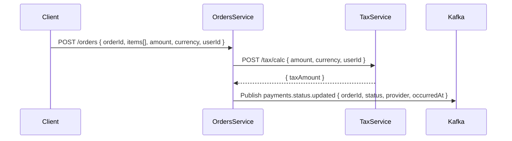

# Interview Case Study

> Staff Automation (QE) Backend - Groupon

- /orders-java/ - Orders Service (Java - Spring Boot)
- /tax-ruby/ - Tax Service (Ruby - Sinatra)
- /docs/ - Documentation and diagrams

## How to Run Orders Service

### Prerequisites
- Docker
- Docker Compose

### Build and Run with Docker Compose

1. Build the Orders service Docker image (from project root):
    ```bash
    docker-compose build orders
    ```
2. Start Orders service and Redpanda (Kafka-compatible):
    ```bash
    docker-compose up
    ```
3. The Orders API will be available at `http://localhost:8080/orders`

### Example Request
```bash
curl -X POST http://localhost:8080/orders \
    -H 'Content-Type: application/json' \
    -d '{
        "orderId": "123",
        "items": ["item1", "item2"],
        "amount": 100.0,
        "currency": "USD",
        "userId": "user-abc"
    }'
```

### Stopping Services
```bash
docker-compose down
```

### Environment Variables
- `KAFKA_BOOTSTRAP_SERVERS`: Kafka/Redpanda bootstrap servers (default: `redpanda:9092`)
- `TAX_SERVICE_URL`: URL for Tax service (default: `http://tax:4567/tax/calc`)

---


## Flow Diagram



## Technologies

- Java 21 with Spring Boot
- Ruby 3.4.6 with Sinatra
- JUnit and RSpec for unit tests
- Pact for consumer/provider contracts
- Kafka/Redpanda for messaging
- Testcontainers or docker-compose for integration tests
- GitHub Actions for CI/CD
