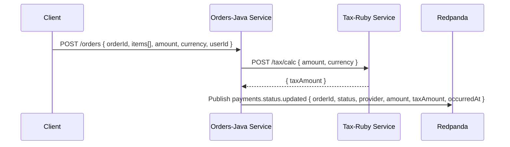

# Development

> **See also: [docs/api.md](docs/api.md)**

## Technologies used

- **Orders:** Java (Spring Boot), Gradle
  - **Test:** JUnit, Pact JVM (consumer), Testcontainers
- **Tax:** Ruby (Sinatra)
  - **Test:** RSpec, Pact Ruby (provider)
- **Messaging:** Redpanda (compatível com Kafka)

## Architecture flow



## Prerequisites

- [Docker](https://docs.docker.com/get-started/get-docker/) installed
- [Docker Compose](https://docs.docker.com/compose/install/) installed
  - Only needed if you use a old Docker version without built-in compose

## Starting the services

Execute the following command:
```sh
  make start
```

> **Note:** This command will execute `orders-java` on port `8080` and trigger . The `tax-ruby` and `redpanda` services run within Docker Compose only and are not exposed to the host machine.

## Docker

All services and tests run in Docker containers. The [Makefile](../Makefile) includes commands to build and run the services.

> **Note:** `orders-java` has 2 Dockerfiles ([Dockerfile](../orders-java/Dockerfile) and [Dockerfile.test](../orders-java/Dockerfile.test)). The test Dockerfile was created to speed up the execution as it doest not need multi-stage build and only copies the source code and runs `gradle testClasses`.

# Testing

Tests are important to ensure the integrity of the project with each change made.

The following services have tests implemented:

- Orders service (Java/Spring Boot) runs on port 8080
- Tax service (Ruby/Sinatra) runs within Docker Compose only (port 4567)
- Kafka (Redpanda) runs within Docker Compose only (port 9092)

## Command overview

Both services have **unit tests** and **Pact contract tests**. The Orders service also has **integration tests** that start Kafka via Testcontainers.

| **Service** | **Test Type** | **Command to run** |
|-------------|---------------|--------------------|
| **Orders**      | Unit          | `make orders-test-unit` |
|             | Contract - Consumer      | `make orders-test-contract` |
|             | Integration - Orders + Kafka | `make orders-test-integration` |
| **Tax**         | Unit          | `make tax-test-unit` |
|             | Contract - Provider      | `make tax-test-contract` |

To run all tests for a service, use:

- Orders: `make orders-test`
- Tax: `make tax-test`

# Continuous Integration (CI)

[](https://github.com/PauloGoncalvesBH/groupon-staff-qe-challenge/actions/workflows/orders-java.yml) | [](https://github.com/PauloGoncalvesBH/groupon-staff-qe-challenge/actions/workflows/tax-ruby.yml)

The following checks are implemented in GitHub Actions workflows:

1. Dockerfile lint ([Hadolint](https://github.com/hadolint/hadolint)) for production and test Dockerfiles
1. Build Orders and Tax images

The following steps are executed only if builds are successful:
1. Run unit tests
1. Run consumer contract tests and upload `./pacts` as an artifact (_Orders_)
1. Run provider contract verification against `./pacts` (_Tax_)
1. Run integration tests (Testcontainers + WireMock) (_Orders_)

# Security

For security purposes, the following measures were implemented:

1. All services, but orders, on `Docker-compose` run on a private network and are not exposed to the host machine.
1. Volumes on `Docker-compose` are read-only by default, being mounted as read-write only when necessary.
1. Base images on all `Dockerfiles` have the *@sha256* digest pinned to avoid using a compromised image.
1. Permissions on all Dockerfiles were set to run as a non-root user.

# Miscellaneous

## Consume messages from `payments.status.updated`

```sh
  docker compose exec redpanda rpk topic consume payments.status.updated
```
